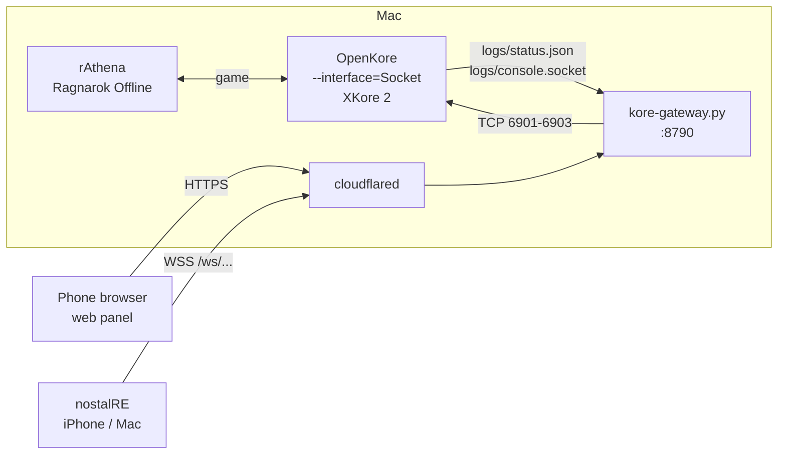

<div align="center">


# OpenKore for Ragnarok Offline

**Run an OpenKore bot on a Ragnarok Offline (rAthena) server, watch it from nostalRE, and control it from your phone's browser.**


[Overview](#overview) · [Web panel](#web-panel) · [Getting started](#getting-started) · [Configuration](#configuration) · [Project layout](#project-layout)

</div>

This is a branch of [OpenKore](https://github.com/OpenKore/openkore). For everything about OpenKore itself (AI settings, macros, commands) see the [OpenKore wiki](https://openkore.com/wiki/).

## Overview

Upstream OpenKore can't talk to a current rAthena server out of the box, has no way to be watched from a modern client, and its GUI is a desktop Wx app. This branch adds:

- **rAthena 2025-07-16 support** — `serverType rAthena_Main20250716`, built on the kRO 2021-11-03 RE packet set, with packet IDs learned from what the server actually sends.
- **XKore 2 for nostalRE** — the bot plays, and a [nostalRE](https://github.com/mike623/nostalre) client logs in to OpenKore to watch the same character live (skills, hotkeys, quests and guild are replayed too).
- **A web control panel** — a near-clone of the Wx interface for the phone: status, map, items, skills, chat, config and control-file editors, NPC dialogs and trades.
- **One public URL for both** — `web/kore-gateway.py` serves the panel and relays nostalRE's game connection over a Cloudflare tunnel, behind a single invitation link.



## Web panel

Open the invitation link (`https://<your host>/#invite=TOKEN`) once; the browser keeps a session cookie and drops the token from the address bar.

| Tab | What you can do |
|---|---|
| **Status** | Level, HP/SP/exp bars, stats with stat-point buttons, status effects, homunculus / mercenary / pet, party and guild, exp report with per-hour rates |
| **Map** | OpenKore's walkability map with you, monsters, players, party, NPCs, portals and ground items. Pinch/drag zoom, follow me, tap to walk, tap an actor to attack / talk / take / PM / trade |
| **Items** | Inventory, cart and storage: use, equip, unequip, drop, sell, move between them |
| **Skills** | Cast on self, a monster, a player or a map cell; add skill levels |
| **Chat** | Public / party / guild / PM tabs with a send box |
| **Config** | Every `config.txt` setting (with wiki help links), raw edit, and editors for `mon_control`, `items_control`, `pickupitems`, `shop`, `timeouts` and more. Every save is backed up and reloaded into the bot |
| **More** | Live console with command history, and the Wx menus as button groups |

NPC conversations pop up as a dialog with the answer choices, and trade requests as a banner. A picker in the header shows item and skill names in English, 繁中 or 简中 (OpenKore itself uses the kRO tables).

> [!IMPORTANT]
> The invitation link is the only key to the panel **and** to the bot's XKore 2 ports. Treat it like a password. Credentials in `config.txt` (username, passwords, PIN, OTP seed) are masked in the panel and can't be changed from the web.

## Getting started

### Requirements

- macOS on Apple silicon, Xcode (for the system Perl headers) and [Homebrew](https://brew.sh) `readline`
- [uv](https://docs.astral.sh/uv/) — provides Python for the build and runs the gateway
- A running Ragnarok Offline / rAthena server (packet version 2025-07-16)
- Optional: `cloudflared` and a domain on Cloudflare for internet access

### 1. Build XSTools

```sh
macos/build.sh
```

`scons` needs a `python` on `PATH`; `macos/bin/python` hands it to uv. `SConstruct` points at Homebrew's readline and the Xcode SDK's Perl 5.34 headers.

### 2. Point OpenKore at your server

`tables/servers.txt` already has the entry:

```ini
[Ragnarok Offline (local)]
ip 127.0.0.1
port 6900
serverType rAthena_Main20250716
serverEncoding Big5
addTableFolders kRO/Ragexe_2021_11_03;kRO
charBlockSize 175
```

Then set these in `control/config.txt`:

```ini
master Ragnarok Offline (local)
server 0
username <game account>
password <game password>
char 0

XKore 2
XKore_listenIp 0.0.0.0
XKore_listenPort 6901
XKore_listenPort_char 6902
XKore_listenPort_map 6903
XKore_publicIp <this Mac's LAN IP>
secureAdminPassword 0
adminPassword <password nostalRE logs in to OpenKore with>
```

> [!NOTE]
> Keep the char and map ports fixed. XKore 2 picks random high ports by default, and nostalRE rejects ports above 32767.

`control/sys.txt` already loads the `webstatus` plugin, which writes `logs/status.json` every second for the panel.

### 3. Run OpenKore

```sh
perl openkore.pl --interface=Socket
```

The Socket interface is what lets the panel stream the console and send commands (`logs/console.socket`). It runs headless, so start it with `nohup … &` or under launchd.

### 4. Run the gateway

```sh
cd web
KORE_HOST=<XKore_publicIp> uv run kore-gateway.py
```

It listens on `127.0.0.1:8790` and prints the invitation link. The token is kept in `web/kore-gateway.invite` (git-ignored) so the link survives restarts.

Check it with:

```sh
uv run kore-gateway.py selftest
```

### 5. Publish it (optional)

Create a Cloudflare tunnel whose ingress sends your hostname to `http://127.0.0.1:8790`, then run it with `cloudflared tunnel run --token <token>`. Open `https://<hostname>/#invite=TOKEN` on the phone.

### 6. Watch from nostalRE

Add OpenKore as a login server in nostalRE's `config.json` and log in with `username` / `adminPassword` from step 2:

```json
{ "name": "OpenKore (internet)", "host": "<hostname>", "port": 6901, "invite": "https://<hostname>/#invite=TOKEN" }
{ "name": "OpenKore (home)", "host": "<XKore_publicIp>", "port": 6901 }
```

> [!TIP]
> Chat lines starting with `;` in nostalRE are sent to OpenKore as commands (`commandPrefix ;`), e.g. `;ai off`.

## Configuration

Gateway environment variables:

| Variable | Default | Purpose |
|---|---|---|
| `KORE_PUBLIC_HOST` | `kore.namike.me` | Public hostname; the only accepted `Origin` |
| `KORE_HOST` | `127.0.0.1` | Where OpenKore's XKore 2 ports listen |
| `KORE_PORTS` | `6901,6902,6903` | The only ports nostalRE may reach |
| `PORT` | `8790` | Local HTTP port for cloudflared |
| `OPENKORE_DIR` | parent of `web/` | OpenKore folder (`logs/`, `control/`, `fields/`, `tables/`) |

The HTTP API and the `status.json` fields are specified in [`web/CONTRACT.md`](web/CONTRACT.md).

## Project layout

```
src/Network/Receive/rAthena/Main20250716.pm  rAthena 2025-07-16 receive packets (shared packet binding for XKore 2)
src/Network/Send/rAthena/Main20250716.pm     send packets
src/Network/XKore2/MapServer.pm              also replays skills, hotkeys, quests, guild
plugins/webstatus/webstatus.pl               writes logs/status.json for the panel
web/kore-gateway.py                          aiohttp gateway: panel, API, console relay, XKore 2 tunnel
web/kore-panel.html                          the web panel (single file, no build)
web/CONTRACT.md                              API and status.json contract
macos/build.sh, macos/bin/python             XSTools build helpers
```

Upstream OpenKore's README is at [OpenKore/openkore](https://github.com/OpenKore/openkore#readme).
